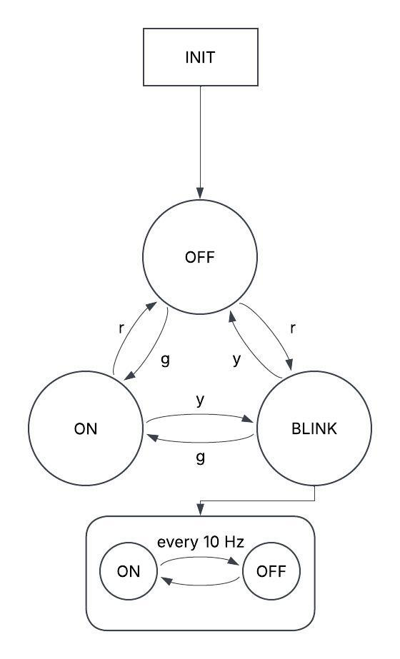

# project documentation

This project is handled as a state machine with the following state diagram:

'r' represents a push of the red button, 'y' represents a push of the yellow button, and 'g' represents a push of the green button. We did this because RED and YELLOW are apparently F' keywords.

### The INIT state
When the device is powered on, it is in the initial state. The initial state's only function is to transition to the off state.

### The OFF state
In the off state, the LED does absolutely nothing. It's a pretty boring state.
#### Entering
The off state is entered automatically from the INIT state or by pressing the red button from any state.

### The ON state
In the off state, the LED is constantly on. It's also pretty boring.
#### Entering
The on state is entered by pressing the green button from any state.

### The BLINK state
Finally, something exciting. The blink state is composed of two substates, conveniently named ON and OFF. 
##### blink/ON
In this state, the LED is constantly ON. It's entered from blink/OFF and leaves for blink/OFF every 10 ticks.
##### blink/OFF
In this state, the LED is constantly off. It's entered from blink/ON and leaves for blink/ON every 10 ticks.
#### Entering
The blink state is entered by pressing the yellow button from any state.

If you press the button associated with a given state while in that same state, nothing happens.

# LedStateMachine F´ project

This project was auto-generated by the F´ utility tool. 

F´ (F Prime) is a component-driven framework that enables rapid development and deployment of spaceflight and other embedded software applications.
**Please Visit the F´ Website:** https://fprime.jpl.nasa.gov.

